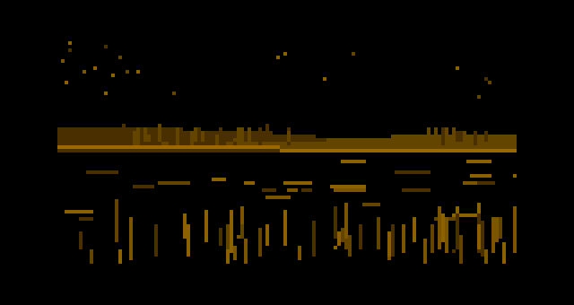
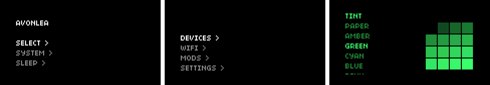
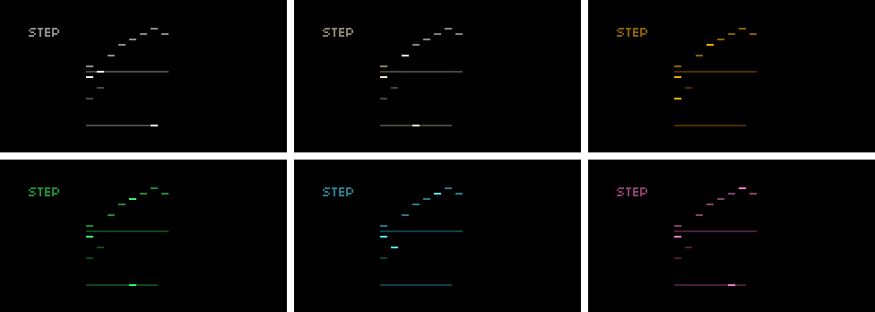
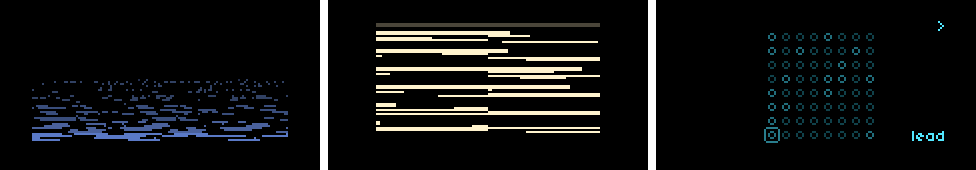

# Uzume

norns scripts on the Cardputer Zero.

Uzume is the norns runtime (matron, crone, softcut and the SuperCollider engine host) built for the Zero. The 128x64 screen is drawn on the 320x170 LCD,
the keyboard stands in for the three keys and three encoders, and sound goes out through PipeWire. Scripts written for norns run as they are.
It comes as one .deb and shows up in the launcher.



## At a glance

| | |
| --- | --- |
| What runs | the original matron, crone, softcut, Lua core and SuperCollider engine host, built from the upstream norns source with 14 small patches |
| Screen | the 128x64 norns picture at 2x (256x128) on the 320x170 LCD. Drawn through DRM, so every frame reaches the LCD (60 Hz measured; `/dev/fb0` alone stops at about 19 Hz). SYSTEM > TINT colours the 16 greys, and the greys are corrected for the LCD so the dim levels show as on the OLED (GAMMA and CONTRAST in SYSTEM > SETTINGS > DISPLAY adjust it) |
| Keys | the built-in keyboard stands in for K1-K3 and E1-E3 (see [Keys](#keys)) |
| Sound | PipeWire's JACK interface, 48 kHz, 2048-frame blocks (about 43 ms) |
| Memory | about 140 MB free while a script runs (idle memory is moved to zram, the desktop's helpers are stopped) |
| Editor | maiden, included, off by default |
| Scripts tried | awake, ong, Avonlea, First Light: run with sound. barcode, o-o-o: load and draw; they need live input or playing to make sound |
| Not there | grid and arc (no serialosc), sc3-plugins, the line input, Wi-Fi / update / restart pages, DISPLAY > BRIGHTNESS; softcut buffers are about 43 s instead of 350 s |

What is different from the original, in detail, is in [docs/DIFFERENCES.md](docs/DIFFERENCES.md).

## Screens

The menus, with SYSTEM > TINT:



The same script (awake) in six of the eight tints:



ong, barcode and o-o-o:



## Install

Install from a computer (macOS or Linux; Windows has `ssh` and `scp` in PowerShell) on the same network as the Zero.
Replace `pi` with your user name on the Zero. If `CardputerZero.local` is not found, use the Zero's IP address instead.

Copy the package to the Zero:

```sh
scp uzume_0.1.5_arm64.deb pi@CardputerZero.local:
```

Log in to the Zero:

```sh
ssh pi@CardputerZero.local
```

Install it (`sudo` asks for your password):

```sh
sudo apt install ./uzume_0.1.5_arm64.deb
```

The same command updates an older version. `sudo apt remove uzume` removes it; your scripts in `~/.local/share/uzume` stay.

Open Uzume in the launcher. The first start takes about 15 seconds. Scripts go in `~/.local/share/uzume/we/dust/code/<name>/<name>.lua`;
restart Uzume after adding a script that has its own SuperCollider engine. Hold Esc for a second, or choose SLEEP in the menu, to go back to the launcher.

## Keys

| Keys | |
| --- | --- |
| `1` `2` `3` | K1 K2 K3 (tap `1` for the system menu) |
| `Backspace` / `Enter` | K2 (back) / K3 (ok) |
| `Q` / `W`, PgUp / PgDn | E1 down / up |
| `A` / `S`, `Z` / `C`, left / right | E2 down / up |
| `X` / `F`, down / up, `-` / `=` | E3 down / up |
| `Shift` | encoders move 4 steps at a time |
| hold `Esc` | quit, back to the launcher (the script opens again next time) |

Hold an encoder key and it keeps turning. SYSTEM > TINT changes the colour of the screen.

## maiden (web editor)

maiden, the norns web editor and console, is included and off by default. Turn it on in `~/.local/share/uzume/maiden.conf`
(`on=1`; the file is made at the first start) and restart Uzume. It uses about 25 MB more memory.

It listens on 127.0.0.1 only, so reach it from a computer through ssh:

```sh
ssh -L 5050:127.0.0.1:5000 -L 5555:127.0.0.1:5555 -L 5556:127.0.0.1:5556 pi@CardputerZero.local
```

then open http://127.0.0.1:5050/maiden/ (with `127.0.0.1`, not `localhost`). Port 5000 on the device appears as 5050 on the
computer because macOS uses 5000 itself (AirPlay); 5555 and 5556 must keep their numbers. `listen=0.0.0.0` in the same file opens it to the
whole network instead. maiden has no password: anyone who can open it can run any code on the device.

## TODO

- Scripts that write `/home/we/...` by hand do not find their files (Uzume's home is `~/.local/share/uzume/we`).
- norns crashes while quitting, after its state is saved. Nothing is lost, but it should end cleanly.
- Long sessions: run scripts for an hour with key and encoder input and watch for dropouts and memory.
- Keys: make the mapping closer to norns' own USB keyboard shortcuts (F1-F4 for the menu pages).
- SETTINGS > DISPLAY > BRIGHTNESS: drive the LCD backlight. SYSTEM > RESTART: restart Uzume.
- grid and arc: add serialosc.
- maiden: try the script catalogue (project install and update).

## Build

You need Docker with arm64 images (Debian 13).

```sh
sh third_party/fetch.sh                                                           # upstream sources, at the commits in third_party/PINS
UZUME_BUFFRAMES=2097152 sh norns-port/build.sh                                    # the patched norns binary
docker build --platform linux/arm64 -t uzume-sc -f sc/build/Dockerfile sc/build   # SuperCollider and JACK
sh packaging/maiden/build-maiden.sh                                               # maiden (Go server, web app in a node:16 container)
sh packaging/collect.sh                                                           # gathers the pieces
sh packaging/build-deb.sh                                                         # out/uzume_0.1.5_arm64.deb
```

The changes to the upstream source are in `norns-port/apply_patches.py` (numbered, with a comment on each) and `norns-port/overlay/`.

## License

GPL-3.0-or-later, see [LICENSE](LICENSE). What Uzume is built from, and under which licenses, is listed in [THIRD_PARTY.md](THIRD_PARTY.md).

Leo Kuroshita ([@kurogedelic](https://github.com/kurogedelic))
